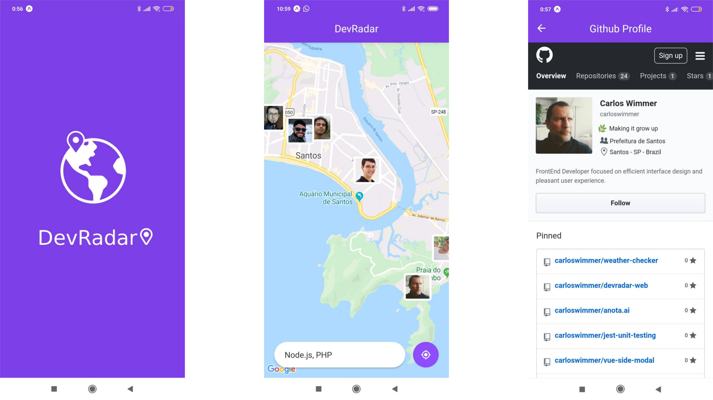

# DevRadar Mobile

<p align="center">
  <a href="https://expo.dev"></a>
  <a href="https://reactnative.dev"></a>
  <a href="https://socket.io"></a>
  <a href="./LICENSE"></a>
</p>

<p align="center">
  <strong>Find developers near you</strong> by tech stack on an interactive map — powered by geolocation and real-time updates.
</p>

<p align="center">
  
</p>

## Overview

**DevRadar Mobile** is the client app for discovering developers who work with technologies you care about (React, Vue, Node, PHP, and more). It shows their positions on a map within **up to 10 km** of your location, using your device’s GPS.

## Features

- **Search by tech** — Filter developers; without a query, you still see the map.
- **Nearby radius** — Results respect the ~10 km distance from your coordinates.
- **Dev profiles** — Tap an avatar to see name, bio, and techs in a callout; tap again to open their **GitHub profile inside the app** (in-app WebView, not the system browser).
- **Live updates** — When a new developer matches your search while you’re browsing, they appear on the map automatically via **Socket.IO**.

## Tech stack

React Native, Expo, React Navigation, React Native Maps, Expo Location, Axios, and Socket.IO client.

## Prerequisites

- [Node.js](https://nodejs.org/) and [Yarn](https://yarnpkg.com/)
- [Expo CLI](https://docs.expo.dev/get-started/installation/) installed globally

To use Yarn global binaries from the terminal, add this to your shell config (e.g. `~/.zshrc` or `~/.bashrc`):

```bash
export PATH="$(yarn global bin):$PATH"
```

## Run locally

```bash
git clone https://github.com/carloswimmer/devradar-mobile.git
cd devradar-mobile
yarn install
yarn start
```

**On your phone**

1. Install **Expo Go** from the App Store or Google Play.
2. Open Expo Go and choose **Scan QR code**.
3. Point the camera at the QR code shown in the terminal or browser.

## License

This project is licensed under the [MIT License](LICENSE).

---

<p align="center">
  Built with React Native & Expo · <a href="https://github.com/carloswimmer/devradar-mobile">devradar-mobile</a>
</p>
